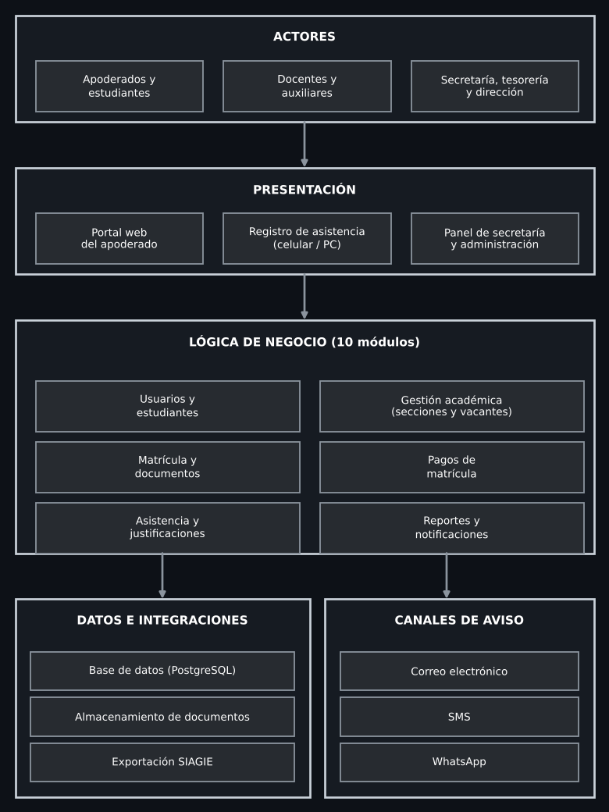

# Arquitectura inicial

## Sistema Web de Gestión de Matrícula y Asistencia para el Colegio Miraflores

La solución propone una aplicación web organizada por capas y módulos para gestionar estudiantes, matrícula, asistencia, notificaciones a apoderados y reportes.

### Diagrama de arquitectura

### Capa de presentación
- Portal del apoderado (solicitud de matrícula, consulta de asistencia, justificaciones)
- Panel de secretaría y dirección (matrículas, reportes)
- Registro de asistencia para docentes y auxiliares (adaptado a celular)
- Panel de administración

### Capa de aplicación
- Gestión de usuarios y roles
- Gestión de estudiantes y apoderados
- Gestión académica (periodos, grados, secciones, vacantes)
- Gestión de matrícula
- Gestión de documentos
- Gestión de pagos
- Gestión de asistencia
- Gestión de justificaciones
- Gestión de notificaciones
- Reportes y exportación

### Capa de dominio
- Estudiante
- Apoderado
- Periodo escolar, Grado y Sección
- Matrícula
- Documento
- Pago
- Asistencia
- Justificación
- Notificación
- Usuario

### Capa de infraestructura
- Base de datos
- Servicio de notificaciones (correo / SMS / WhatsApp)
- Almacenamiento de documentos adjuntos
- Exportación para SIAGIE

### Flujo básico de matrícula
1. El apoderado (o secretaría) registra la solicitud de matrícula.
2. Se adjuntan los documentos requeridos.
3. Secretaría valida los documentos.
4. Tesorería registra el pago de matrícula.
5. El sistema verifica matrícula única y vacante disponible en la sección.
6. Se confirma la matrícula y se emite la constancia.
7. Se notifica al apoderado.

### Flujo básico de asistencia
1. El docente abre la lista de su sección en el día.
2. Registra presente, tardanza o falta de cada estudiante.
3. El sistema guarda la asistencia.
4. Se notifica a los apoderados de faltas y tardanzas.
5. El apoderado puede enviar una justificación, que el auxiliar aprueba o rechaza.
