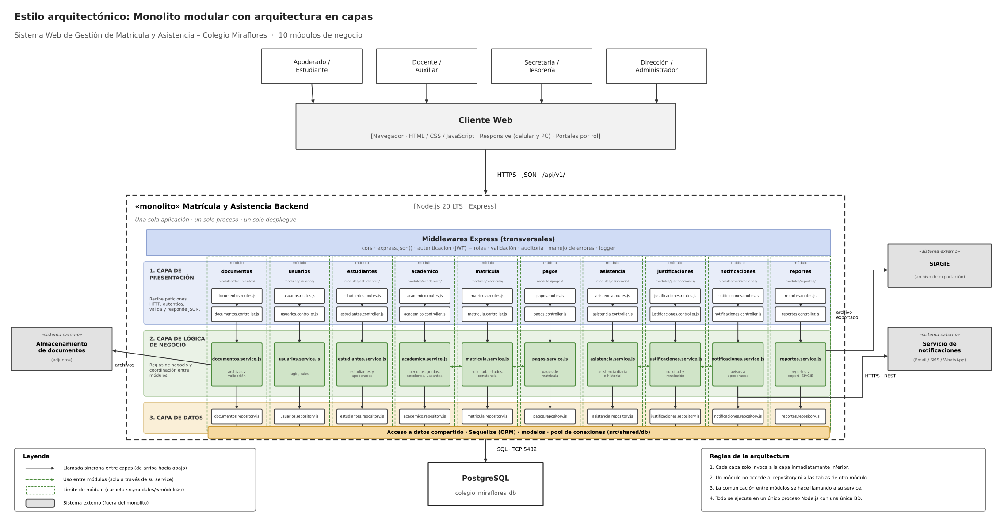

# Estilo arquitectónico

## Sistema Web de Gestión de Matrícula y Asistencia para el Colegio Miraflores

### Estilo seleccionado: Monolito modular con arquitectura en capas

El sistema se construye como **una sola aplicación, un solo proceso y un solo despliegue** (monolito), internamente organizada en **módulos de negocio independientes** y estructurada en **tres capas** (presentación, lógica de negocio y datos). Los módulos se comunican entre sí únicamente a través de sus servicios, y toda la persistencia se realiza sobre una única base de datos.

### Tecnologías de referencia
| Elemento | Tecnología |
|---|---|
| Backend | Node.js 20 LTS + Express |
| Cliente web | Navegador (HTML / CSS / JavaScript), responsive |
| Comunicación cliente-servidor | HTTPS + JSON (`/api/v1/`) |
| Acceso a datos | Sequelize (ORM) + pool de conexiones |
| Base de datos | PostgreSQL |
| Almacenamiento de documentos | Sistema de archivos / almacenamiento de objetos |

### Diagrama de arquitectura



### Capas

| Capa | Responsabilidad | Componentes |
|---|---|---|
| **1. Presentación** | Recibe peticiones HTTP, autentica, valida la entrada y responde JSON. | `*.routes.js`, `*.controller.js` |
| **2. Lógica de negocio** | Reglas de negocio y coordinación entre módulos. | `*.service.js` |
| **3. Datos** | Persistencia y consultas a la base de datos. | `*.repository.js`, Sequelize, modelos |

### Middlewares transversales (Express)
- `cors`
- `express.json()`
- Autenticación (JWT) y control de roles (Administrador, Secretaría, Tesorería, Director, Docente, Auxiliar, Apoderado, Estudiante)
- Validación de entrada
- Auditoría de cambios
- Manejo de errores
- Logger

### Módulos del monolito (`src/modules/<módulo>/`)

El monolito se divide en **10 módulos** de negocio, cada uno con responsabilidad única:

| Módulo | Responsabilidad | Requisitos que cubre |
|---|---|---|
| **usuarios** | Registro, login y administración de roles. | RF01 |
| **estudiantes** | Datos de estudiantes y apoderados, y su relación familiar. | RF02 |
| **academico** | Periodo escolar, grados, secciones, capacidad y vacantes. | RF03 |
| **matricula** | Solicitud de matrícula, tipos, estados, validación de reglas y constancia. | RF04, RF06 |
| **documentos** | Carga, almacenamiento y validación de documentos (requisitos de matrícula y sustentos). | RF05 |
| **pagos** | Registro y consulta de pagos de matrícula y su estado. | RF13 |
| **asistencia** | Registro diario de asistencia por sección e historial. | RF07, RF10 |
| **justificaciones** | Solicitud y resolución de justificaciones de inasistencia. | RF08 |
| **notificaciones** | Envío de avisos a apoderados por distintos canales. | RF09 |
| **reportes** | Reportes de matrícula, vacantes, pagos y asistencia; exportación para SIAGIE. | RF11, RF12 |

### Estructura de carpetas propuesta

```
src/
├── modules/
│   ├── usuarios/         (routes, controller, service, repository)
│   ├── estudiantes/      (routes, controller, service, repository)
│   ├── academico/        (routes, controller, service, repository)
│   ├── matricula/        (routes, controller, service, repository)
│   ├── documentos/       (routes, controller, service, repository)
│   ├── pagos/            (routes, controller, service, repository)
│   ├── asistencia/       (routes, controller, service, repository)
│   ├── justificaciones/  (routes, controller, service, repository)
│   ├── notificaciones/   (routes, controller, service, repository)
│   └── reportes/         (routes, controller, service, repository)
├── middlewares/
└── shared/
    └── db/               (Sequelize, modelos, pool de conexiones)
```

### Colaboración entre módulos (solo mediante services)
- **matricula** consulta a **academico** (reservar vacante), **documentos** (documentos completos), **pagos** (pago registrado) y **estudiantes**.
- **justificaciones** usa **asistencia** (marcar como justificada) y **documentos** (sustentos).
- **asistencia**, **justificaciones**, **matricula** y **pagos** usan **notificaciones** para avisar al apoderado.
- **reportes** lee información de todos los módulos a través de sus services.

### Sistemas externos (fuera del monolito)
- **Servicio de notificaciones** (correo / SMS / WhatsApp): comunicación vía HTTPS / REST desde `notificaciones.service`.
- **SIAGIE**: el módulo `reportes` genera archivos de exportación compatibles con el formato requerido.
- **Almacenamiento de documentos**: usado por el módulo `documentos` para los archivos adjuntos de matrícula y sustentos de justificación.

### Reglas de la arquitectura
1. Cada capa solo invoca a la capa inmediatamente inferior.
2. Un módulo no accede al repository ni a las tablas de otro módulo.
3. La comunicación entre módulos se hace llamando a su service.
4. Todo se ejecuta en un único proceso Node.js con una única base de datos.

### Leyenda
- Flecha sólida: llamada síncrona entre capas (de arriba hacia abajo).
- Flecha punteada: uso entre módulos (solo a través de su service).
- Límite de módulo: carpeta `src/modules/<módulo>/`.
- Sistema externo: fuera del monolito.

### Justificación del estilo frente a los drivers

| Driver | Cómo lo satisface el estilo |
|---|---|
| DA01 Disponibilidad | Un solo despliegue simple de operar; se puede replicar la instancia detrás de un balanceador. |
| DA02 Rendimiento y concurrencia | Llamadas en proceso entre módulos (sin latencia de red); índices en PostgreSQL para consultas por sección y fecha. |
| DA03 Seguridad y privacidad | Punto único de entrada con middlewares de autenticación JWT, roles, validación y auditoría. |
| DA04 Integridad de datos | Una sola base de datos con transacciones y restricciones únicas (matrícula única, control de vacantes). |
| DA05 Integración | Integraciones externas aisladas en `notificaciones`, `documentos` y `reportes`. |
| DA06 Usabilidad | API JSON simple que alimenta clientes web claros, por rol y adaptados a celular. |
| DA07 Escalabilidad | Escalado horizontal de instancias; los módulos pueden extraerse a servicios si fuera necesario. |
| DA08 Mantenibilidad | Límites claros por módulo y capa; reglas que evitan acoplamiento. |
