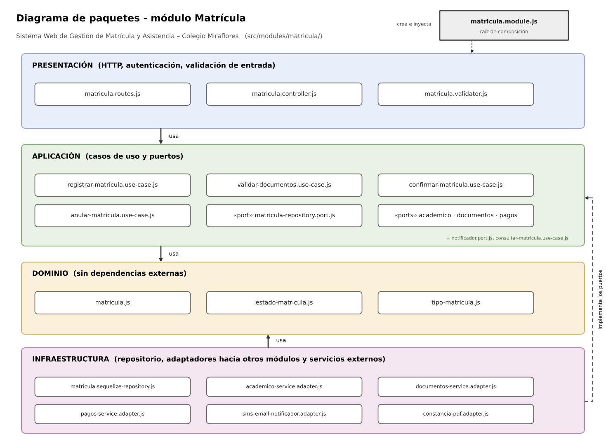

# 1. Capas del módulo y regla de dependencia

## Sistema Web de Gestión de Matrícula y Asistencia para el Colegio Miraflores

Cada módulo del monolito (`usuarios`, `estudiantes`, `academico`, `matricula`, `documentos`, `pagos`, `asistencia`, `justificaciones`, `notificaciones`, `reportes`) se organiza con las cuatro capas de Clean Architecture definidas en el [enfoque arquitectónico](../arquitectura/enfoque-arquitectonico.md). Como ejemplo se detalla el módulo **Matrícula**, el más importante del sistema; los demás módulos siguen la misma estructura.



**Regla de dependencia:** el código solo puede importar hacia el centro (dominio). El dominio no conoce Express, PostgreSQL, Sequelize ni los proveedores de mensajería, almacenamiento o SIAGIE.

| Capa | Contiene | Responsabilidad | Puede depender de | No puede depender de |
|---|---|---|---|---|
| **Dominio** | Entidades (Matricula), enumeraciones (EstadoMatricula, TipoMatricula) | Reglas de negocio de la matrícula que serán ciertas con cualquier tecnología: estados válidos, transiciones y condiciones para confirmar (documentos completos y pago registrado). | Nada externo | Aplicación, infraestructura, presentación, Express, ORM, SDK |
| **Aplicación** | Casos de uso (RegistrarMatricula, ValidarDocumentos, ConfirmarMatricula, AnularMatricula, ConsultarMatricula) y puertos (interfaces) | Orquestar el flujo: qué paso va primero y qué hacer si falla un servicio externo. | Dominio | Infraestructura, presentación, Express, ORM |
| **Infraestructura** | Repositorio concreto (Sequelize + PostgreSQL) y adaptadores hacia otros módulos (`academico`, `documentos`, `pagos`) y servicios externos (notificaciones, constancia PDF) | Implementar los puertos definidos en la capa de aplicación con una tecnología concreta. | Aplicación (puertos), dominio, librerías externas | Presentación |
| **Presentación** | Rutas, controladores y validadores de entrada | Recibir la petición HTTP, autenticar, validar la entrada y responder JSON. | Aplicación | Dominio directamente, infraestructura, ORM |

## Raíz de composición

`matricula.module.js` es el único archivo que conoce todas las capas: crea los adaptadores concretos (`MatriculaSequelizeRepository`, `AcademicoServiceAdapter`, `DocumentosServiceAdapter`, `PagosServiceAdapter`, `SmsEmailNotificadorAdapter`), los inyecta en los casos de uso y entrega el controlador ya construido a las rutas. Gracias a esto se puede cambiar el proveedor de mensajería o incorporar una pasarela de pagos sin tocar el dominio ni los casos de uso.

**Colaboración entre módulos:** el módulo `matricula` no accede a las tablas de `academico`, `documentos` ni `pagos`; usa sus *services* a través de los puertos `AcademicoPort`, `DocumentosPort` y `PagosPort`, implementados por adaptadores de infraestructura (regla DEC08).

## Estructura de carpetas del módulo

```
src/modules/matricula/
├── presentacion/
│   ├── matricula.routes.js
│   ├── matricula.controller.js
│   └── matricula.validator.js
├── aplicacion/
│   ├── registrar-matricula.use-case.js
│   ├── validar-documentos.use-case.js
│   ├── confirmar-matricula.use-case.js
│   ├── anular-matricula.use-case.js
│   ├── consultar-matricula.use-case.js
│   ├── matricula-repository.port.js
│   ├── academico.port.js
│   ├── documentos.port.js
│   ├── pagos.port.js
│   └── notificador.port.js
├── dominio/
│   ├── matricula.js
│   ├── estado-matricula.js
│   └── tipo-matricula.js
├── infraestructura/
│   ├── matricula.sequelize-repository.js
│   ├── academico-service.adapter.js
│   ├── documentos-service.adapter.js
│   ├── pagos-service.adapter.js
│   ├── sms-email-notificador.adapter.js
│   └── constancia-pdf.adapter.js
└── matricula.module.js
```
