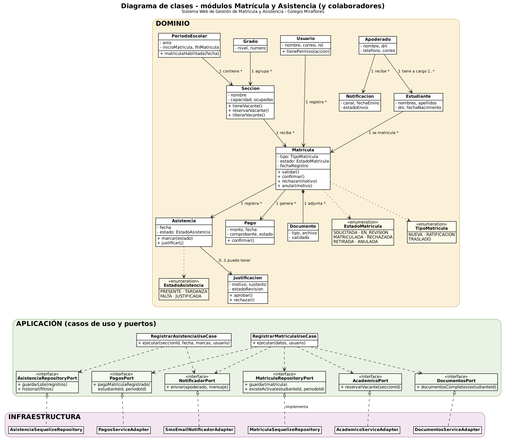

# 2. Diagrama de clases

## Sistema Web de Gestión de Matrícula y Asistencia para el Colegio Miraflores

Diagrama de clases de los módulos **Matrícula** y **Asistencia** y de las entidades de los módulos con los que colaboran (`academico`, `documentos`, `pagos`, `justificaciones`, `estudiantes`), organizado por capas: dominio (entidades y enumeraciones), aplicación (casos de uso y puertos) e infraestructura (adaptadores).

## Descripción de las clases

| Clase | Capa | Módulo | Descripción | Requisitos |
|---|---|---|---|---|
| **Usuario** | Dominio | usuarios | Persona con rol (Administrador, Secretaría, Tesorería, Director, Docente, Auxiliar, Apoderado, Estudiante). | RF01 |
| **Estudiante** | Dominio | estudiantes | Alumno del colegio con sus datos personales. | RF02 |
| **Apoderado** | Dominio | estudiantes | Adulto responsable de uno o más estudiantes; recibe las notificaciones. | RF02, RF09 |
| **PeriodoEscolar** | Dominio | academico | Año escolar con fechas de matrícula habilitada. | RF03 |
| **Grado** | Dominio | academico | Nivel y grado académico (por ejemplo, 3.° de secundaria). | RF03 |
| **Seccion** | Dominio | academico | Grupo de estudiantes de un grado y periodo, con capacidad y vacantes. | RF03 |
| **Matricula** | Dominio | matricula | Entidad principal: une estudiante, sección y periodo; tipo, estado y reglas de validación. | RF04, RF06 |
| **Documento** | Dominio | documentos | Archivo requerido para la matrícula o sustento de una justificación, con su estado de validación. | RF05 |
| **Pago** | Dominio | pagos | Pago de matrícula de un estudiante (monto, fecha, comprobante y estado). | RF13 |
| **Asistencia** | Dominio | asistencia | Registro diario de un estudiante matriculado (presente, tardanza, falta, justificada). | RF07, RF10 |
| **Justificacion** | Dominio | justificaciones | Motivo y sustento de una inasistencia, con estado de revisión. | RF08 |
| **Notificacion** | Dominio | notificaciones | Aviso enviado a un apoderado por un canal (correo, SMS, WhatsApp). | RF09 |
| **EstadoMatricula / TipoMatricula / EstadoAsistencia** | Dominio | matricula / asistencia | Enumeraciones del dominio. | RF04, RF07 |
| **RegistrarMatriculaUseCase** | Aplicación | matricula | Orquesta el registro: verifica matrícula única, documentos y pago, reserva vacante, guarda y notifica. | RF04, RF09 |
| **RegistrarAsistenciaUseCase** | Aplicación | asistencia | Orquesta el registro de asistencia de una sección y el aviso de faltas. | RF07, RF09 |
| **MatriculaRepositoryPort / AcademicoPort / DocumentosPort / PagosPort / AsistenciaRepositoryPort / NotificadorPort** | Aplicación | matricula / asistencia | Interfaces (puertos) que la infraestructura implementa. Los puertos hacia otros módulos se resuelven con sus *services*. | RF04, RF07, RF09 |
| **MatriculaSequelizeRepository / AcademicoServiceAdapter / DocumentosServiceAdapter / PagosServiceAdapter / AsistenciaSequelizeRepository / SmsEmailNotificadorAdapter** | Infraestructura | matricula / asistencia | Implementaciones concretas: repositorios con Sequelize/PostgreSQL, adaptadores hacia los services de otros módulos y proveedor de notificaciones. | RF04, RF07, RF09 |

## Relaciones principales

- Un **Apoderado** tiene a su cargo uno o más **Estudiantes**.
- Un **Periodo escolar** contiene muchos **Grados** con sus **Secciones**; cada **Sección** pertenece a un **Grado**.
- Una **Matrícula** une un **Estudiante** con una **Sección** (y por ella con un periodo), tiene (composición) muchos **Documentos** y genera uno o más **Pagos**.
- Una **Matrícula** registra muchas **Asistencias** (una por día) y una **Asistencia** puede tener una **Justificación**.
- Una **Asistencia** de falta o tardanza genera **Notificaciones** al **Apoderado**.
- Los casos de uso dependen de **puertos**, no de las implementaciones; los **adaptadores** implementan los puertos.

```mermaid
classDiagram
    class Usuario {
        -int id
        -string nombre
        -string correo
        -Rol rol
        +tienePermiso(accion) bool
    }
    class Apoderado {
        -int id
        -string nombre
        -string dni
        -string telefono
        -string correo
    }
    class Estudiante {
        -int id
        -string nombres
        -string apellidos
        -string dni
        -Date fechaNacimiento
    }
    class PeriodoEscolar {
        -int id
        -int anio
        -Date inicioMatricula
        -Date finMatricula
        +matriculaHabilitada(fecha) bool
    }
    class Grado {
        -int id
        -string nivel
        -int numero
    }
    class Seccion {
        -int id
        -string nombre
        -int capacidad
        -int ocupadas
        +tieneVacante() bool
        +reservarVacante() void
        +liberarVacante() void
    }
    class Matricula {
        -int id
        -TipoMatricula tipo
        -EstadoMatricula estado
        -Date fechaRegistro
        +validar() void
        +confirmar() void
        +rechazar(motivo) void
        +anular(motivo) void
    }
    class Documento {
        -int id
        -string tipo
        -string archivo
        -bool validado
    }
    class Asistencia {
        -int id
        -Date fecha
        -EstadoAsistencia estado
        +marcar(estado) void
        +justificar(j) void
    }
    class Justificacion {
        -int id
        -string motivo
        -string sustento
        -string estadoRevision
        +aprobar() void
        +rechazar() void
    }
    class Pago {
        -int id
        -float monto
        -Date fecha
        -string comprobante
        -string estado
        +confirmar() void
    }
    class Notificacion {
        -int id
        -string canal
        -Date fechaEnvio
        -string estadoEnvio
    }
    class EstadoMatricula {
        <<enumeration>>
        SOLICITADA
        EN_REVISION
        MATRICULADA
        RECHAZADA
        RETIRADA
        ANULADA
    }
    class TipoMatricula {
        <<enumeration>>
        NUEVA
        RATIFICACION
        TRASLADO
    }
    class EstadoAsistencia {
        <<enumeration>>
        PRESENTE
        TARDANZA
        FALTA
        JUSTIFICADA
    }
    class RegistrarMatriculaUseCase {
        +ejecutar(datos, usuario) Matricula
    }
    class RegistrarAsistenciaUseCase {
        +ejecutar(seccionId, fecha, marcas, usuario) Asistencia[]
    }
    class MatriculaRepositoryPort {
        <<interface>>
        +guardar(matricula) Matricula
        +existeActiva(estudianteId, periodoId) bool
    }
    class AcademicoPort {
        <<interface>>
        +reservarVacante(seccionId) Seccion
    }
    class DocumentosPort {
        <<interface>>
        +documentosCompletos(estudianteId) bool
    }
    class PagosPort {
        <<interface>>
        +pagoMatriculaRegistrado(estudianteId, periodoId) bool
    }
    class AsistenciaRepositoryPort {
        <<interface>>
        +guardarLote(registros) Asistencia[]
        +historial(filtros) Asistencia[]
    }
    class NotificadorPort {
        <<interface>>
        +enviar(apoderado, mensaje) ResultadoEnvio
    }
    class MatriculaSequelizeRepository
    class AcademicoServiceAdapter
    class DocumentosServiceAdapter
    class PagosServiceAdapter
    class AsistenciaSequelizeRepository
    class SmsEmailNotificadorAdapter

    Apoderado "1" --> "1..*" Estudiante : tiene a cargo
    PeriodoEscolar "1" --> "*" Seccion : contiene
    Grado "1" --> "*" Seccion : agrupa
    Estudiante "1" --> "*" Matricula : se matricula
    Seccion "1" --> "*" Matricula : recibe
    Matricula "1" *-- "*" Documento : adjunta
    Matricula "1" --> "*" Pago : genera
    Matricula "1" --> "*" Asistencia : registra
    Asistencia "1" --> "0..1" Justificacion : puede tener
    Asistencia "*" ..> "1" Apoderado : notifica a
    Apoderado "1" --> "*" Notificacion : recibe
    Usuario "1" --> "*" Matricula : registra
    Matricula ..> EstadoMatricula
    Matricula ..> TipoMatricula
    Asistencia ..> EstadoAsistencia
    RegistrarMatriculaUseCase ..> Matricula : usa
    RegistrarMatriculaUseCase ..> MatriculaRepositoryPort : usa
    RegistrarMatriculaUseCase ..> AcademicoPort : usa
    RegistrarMatriculaUseCase ..> DocumentosPort : usa
    RegistrarMatriculaUseCase ..> PagosPort : usa
    RegistrarMatriculaUseCase ..> NotificadorPort : usa
    RegistrarAsistenciaUseCase ..> AsistenciaRepositoryPort : usa
    RegistrarAsistenciaUseCase ..> NotificadorPort : usa
    MatriculaSequelizeRepository ..|> MatriculaRepositoryPort
    AcademicoServiceAdapter ..|> AcademicoPort
    DocumentosServiceAdapter ..|> DocumentosPort
    PagosServiceAdapter ..|> PagosPort
    AsistenciaSequelizeRepository ..|> AsistenciaRepositoryPort
    SmsEmailNotificadorAdapter ..|> NotificadorPort
```

Código Mermaid (editable, se visualiza en GitHub)

