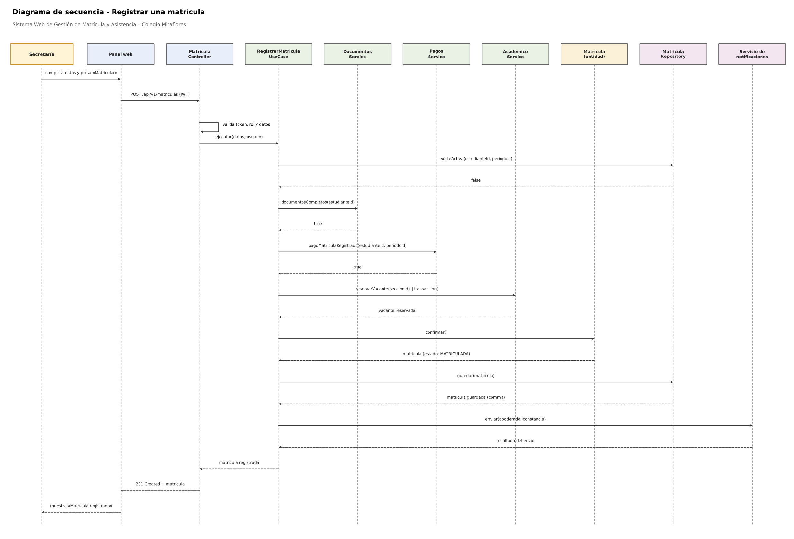
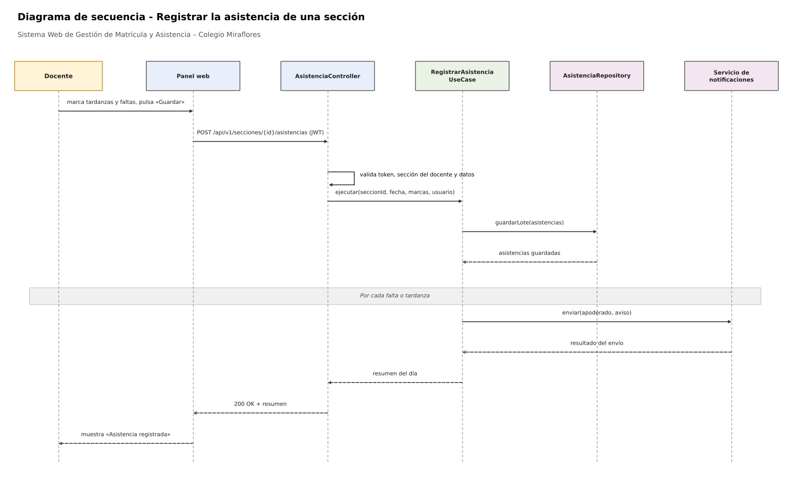
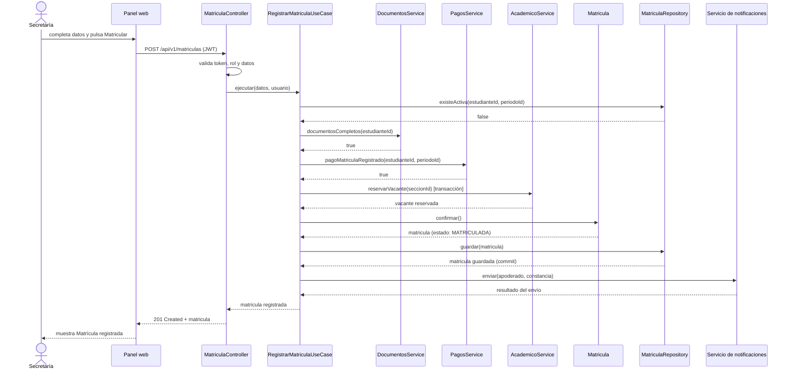
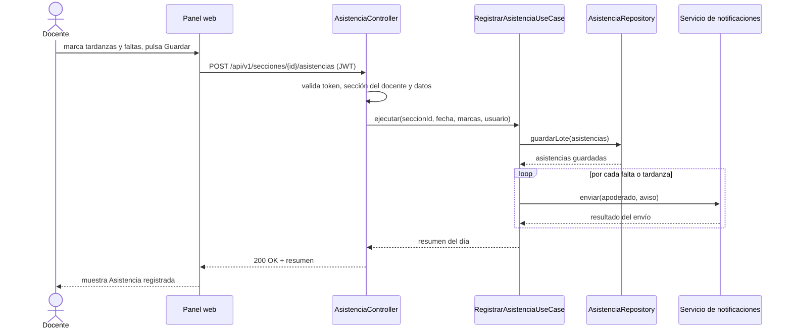

# 3. Diagramas de secuencia

## Sistema Web de Gestión de Matrícula y Asistencia para el Colegio Miraflores

Se presentan las secuencias de los dos casos de uso centrales del sistema, que recorren las cuatro capas de cada módulo. Corresponden a los flujos descritos en el [enfoque arquitectónico](../arquitectura/enfoque-arquitectonico.md).

---

## 3.1 Registrar una matrícula (RF04, RF05, RF09, RF13)

### Descripción del flujo

1. Secretaría completa los datos del estudiante, el grado y la sección, y pulsa «Matricular» en el panel web.
2. El panel envía `POST /api/v1/matriculas` con el token JWT.
3. El controlador valida el token, el rol y los datos de entrada.
4. El controlador invoca el caso de uso `RegistrarMatriculaUseCase`.
5. El caso de uso verifica que el estudiante no tenga una matrícula activa en el periodo.
6. Consulta al módulo `documentos` si los documentos requeridos están completos y validados.
7. Consulta al módulo `pagos` si el pago de matrícula está registrado.
8. Solicita al módulo `academico` reservar una vacante en la sección (transacción con bloqueo de la fila).
9. La entidad `Matricula` valida sus reglas (periodo habilitado, tipo y estado) y pasa a *MATRICULADA*.
10. El repositorio guarda la matrícula y confirma la transacción.
11. El caso de uso envía al apoderado el aviso y la constancia mediante el servicio de notificaciones.
12. El controlador responde `201 Created` y el panel muestra la confirmación.

**Flujos alternativos**
- Si el estudiante ya tiene una matrícula activa en el periodo, o la sección no tiene vacantes, el caso de uso responde `409 Conflict` y no se guarda nada.
- Si faltan documentos, el pago de matrícula no está registrado o la matrícula incumple las reglas del dominio (periodo cerrado), se lanza `MatriculaInvalidaError` y el controlador responde `422`; se revierte la transacción y se libera la vacante.
- Si el servicio de notificaciones falla, la matrícula permanece registrada y el envío se reintenta (el núcleo del sistema sigue disponible).

---

## 3.2 Registrar la asistencia de una sección (RF07, RF09)

### Descripción del flujo

1. El docente abre la lista de su sección del día; todos los estudiantes aparecen como *PRESENTE*.
2. El docente marca las tardanzas y las faltas y pulsa «Guardar».
3. El panel envía `POST /api/v1/secciones/{id}/asistencias` con el token JWT.
4. El controlador valida el token, que la sección pertenezca al docente y los datos.
5. El controlador invoca `RegistrarAsistenciaUseCase`.
6. El caso de uso crea las asistencias del día y las guarda en un solo lote.
7. Por cada falta o tardanza, el caso de uso envía un aviso al apoderado.
8. El controlador responde `200 OK` con el resumen del día.

**Flujos alternativos**
- Si ya existe asistencia registrada para esa sección y fecha, solo el personal autorizado puede corregirla y el cambio queda en la bitácora de auditoría.
- Si el servicio de notificaciones falla, la asistencia queda guardada y los avisos pendientes se reintentan.

Código Mermaid (editable, se visualiza en GitHub)

